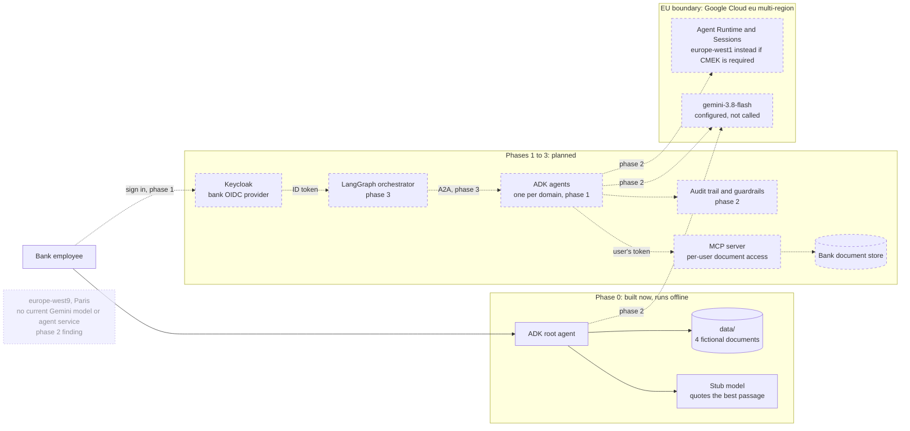

# Go-live review of an AI agent for a regulated French bank

> **Work in progress, phase 0 of 4. Not yet run against Gemini.**

**[Read the documentation site](https://yassineteimi.github.io/gemini-agent-golive-review/)**

Banque Ardoise is a fictional regulated French bank whose staff want an AI agent that answers questions from internal procedures: how to handle a disputed card payment, how long a complaint file is kept, who may read which document. This repository takes that request the way a Google Cloud customer engineer would on a real deal. It checks during the technical evaluation that the use case can go live, designs how the agent plugs into the bank's identity, connectors and residency rules, scopes the work for a Forward Deployed Engineering team, and logs the bugs and workarounds met on the way. The agent uses Google's Agent Development Kit (ADK) on Gemini Enterprise Agent Platform, formerly Vertex AI.

It's written for engineers who know the platform and want evidence rather than claims. Every finding links to its source, and [docs/simulated.md](docs/simulated.md) lists everything that's faked.

## What the first check found

The brief said "run everything in Paris". Before any code, the region checks showed that no current Gemini model, Agent Runtime or session store runs in `europe-west9`, and that the only Gemini model that processed data inside France retired on 20 October 2026. The SDK also accepts `europe-west9` silently and fails only on the first real call. The design therefore uses the `eu` multi-region, which keeps processing inside the EU, and Paris residency becomes the phase 2 question. All eight findings, with sources: [docs/findings.md](docs/findings.md).

## Target architecture



Solid boxes and arrows are what phase 0 builds and runs on a laptop with no network; dashed ones are planned for the phase on their label, and the Paris box marks where the original brief wanted everything to run. Details in [docs/architecture.md](docs/architecture.md).

## Roadmap

| Phase | Adds | Status |
|---|---|---|
| 0 | ADK agent answering from four fictional documents, Gemini (`gemini-3.8-flash` on `eu`) configured but not called, offline tests in CI, feasibility scorecard draft, ADR 0001, docs site | In progress |
| 1 | Sign-in through Keycloak (OIDC); each user sees only their own documents through an MCP server; several ADK agents with routing | Planned |
| 2 | Each service pinned to `europe-west9` or to the nearest EU option, with a written finding where Paris isn't offered; audit trail; guardrails | Planned |
| 3 | Orchestrator rebuilt in LangGraph, talking to the ADK agents over A2A | Planned |
| 4 | Go-live write-up: integration design, engagement request for the Forward Deployed Engineering team, bug and workaround log with product feedback | Planned |

## Run the offline tests

You need Python 3.11 or newer and [uv](https://docs.astral.sh/uv/). No Google Cloud account, no credentials, no network calls: the tests block every outgoing connection.

```sh
make install   # uv sync --locked: google-adk 2.15.0, google-genai 2.34.0
make test      # pytest, offline
make lint      # ruff
make run       # chat with the agent on the stub model
```

GitHub Actions runs `make lint` and `make test` on Python 3.11 and 3.14 on every push.

## Read next

- [Feasibility scorecard](docs/feasibility-scorecard.md): the seven questions a bank asks before go-live, and how and when this project answers each one
- [ADR 0001](docs/adr/0001-adk-first-langgraph-later.md): ADK first, LangGraph orchestrator later, A2A between them, and the five options left out
- [Findings](docs/findings.md): every gap between the plan, the docs and the product, with sources
- [What is simulated](docs/simulated.md): the stub model, the fictional documents, and what each phase makes real
