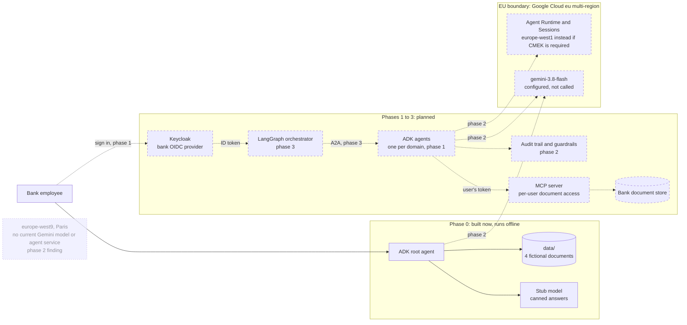

# Target architecture

!!! warning "Work in progress, phase 0 of 4. Not yet run against Gemini."
    Phase 0 runs the agent against an offline stub model. The Gemini and Google Cloud boxes below are configured or planned, never called.

Solid boxes and arrows are what phase 0 builds and runs on a laptop with no network; dashed ones are planned for the phase on their label, and the Paris box marks where the original brief wanted everything to run.

## The parts

| Part | Phase | What it does here |
|---|---|---|
| ADK root agent | 0 | Answers staff questions from the documents in `data/`. Built with `google-adk` 2.15.0 ([F1](findings.md#f1-adk-release-and-python-support)). |
| Stub model | 0 | Implements ADK's model interface and returns canned answers, so tests need no credentials and cost nothing. Listed in [What is simulated](simulated.md). |
| Gemini on the `eu` endpoint | Configured in 0, called from 2 | `gemini-3.8-flash` with `GOOGLE_CLOUD_LOCATION=eu` and `GOOGLE_GENAI_USE_ENTERPRISE=true` ([F2](findings.md#f2-vertex-ai-renamed-and-the-switch-that-goes-with-it)). The SDK sends `eu` to `aiplatform.eu.rep.googleapis.com` by itself. |
| Keycloak | 1 | Stands in for the bank's identity provider. Staff sign in once; the agents act with that user's rights. The choice between Keycloak and Google Cloud identity services is ADR 0002. |
| MCP server | 1 | Sits in front of the document store and returns only what the signed-in user may read, following the bank's [internal access policy](https://github.com/yassineteimi/gemini-agent-golive-review/blob/main/data/internal-access-policy.md). The alternative, Gemini Enterprise's own connectors, is ADR 0003. |
| ADK agents | 1 | One agent per domain (payments, compliance, HR) with routing from the root agent. |
| Audit trail and guardrails | 2 | Logs every question and answer for the 90 days the bank's retention policy sets, and checks inputs and outputs against policy. |
| LangGraph orchestrator | 3 | Rebuilds the routing layer in LangGraph and calls the ADK agents over A2A, to show ADK agents working under an orchestrator the bank may already run. See [ADR 0001](adr/0001-adk-first-langgraph-later.md). |
| Agent Runtime and Sessions | 2 | Hosting and conversation state on Google Cloud, on the `eu` multi-region or a single EU region. |

## Where it runs, and why not Paris

The brief asked for `europe-west9`. Four findings rule that out for the parts that matter most, as of 22 November 2026:

- No current Gemini model has a `europe-west9` endpoint. Every current GA model is served on the `eu` multi-region, which keeps ML processing inside EU member states ([F3](findings.md#f3-gemini-models-and-europe-west9)). The SDK accepts `location="europe-west9"` and builds the URL without complaint, so the mistake only shows up on the first call.
- The only Gemini model that processed data inside France, `gemini-2.5-flash`, retired on 20 October 2026 ([F4](findings.md#f4-ml-processing-inside-france)).
- Agent Runtime, Sessions, Memory Bank, Sandboxes and Agent Gateway aren't offered in `europe-west9` ([F5](findings.md#f5-agent-services-and-europe-west9)).
- Agent Runtime can't use customer-managed encryption keys on the `eu` multi-region ([F6](findings.md#f6-cmek-and-the-eu-endpoint)). A bank that wants its own keys runs the agent in a single EU region such as `europe-west1` and calls the model on `eu`.

So the target keeps the model on `eu` and puts Agent Runtime and Sessions either on `eu` or in `europe-west1`, depending on whether Banque Ardoise's compliance team ranks the EU processing boundary or its own encryption keys higher. Phase 2 records that choice in ADR 0004, together with anything that can run in Paris, such as the document store.

Official sources: [Gemini Enterprise Agent Platform locations](https://docs.cloud.google.com/gemini-enterprise-agent-platform/resources/locations#europe), [data residency](https://docs.cloud.google.com/gemini-enterprise-agent-platform/resources/data-residency#ml-processing-google-models), [agent service locations](https://docs.cloud.google.com/gemini-enterprise-agent-platform/resources/agent-locations).
